# Vault-Share

Secure file sharing: a Flask web app for sharing confidential files between
users. Each file is encrypted at rest with its own AES-256-GCM key, kept
only as copies encrypted to the public key of each person allowed to open
it, checked with SHA-256 and an HMAC, and signed with an ECDSA key certified
by a local CA.

<!-- The pictures live in docs/screenshots/; replace a file there to update it here. -->

## Features

- Every file has its own AES-256-GCM key, stored only as copies encrypted
  with HPKE (X25519) for its owner and each person it is shared with: the
  server's own keys cannot open a stored file.
- Files are signed with ECDSA P-256 keys certified by a local OpenSSL CA,
  with revocation and a signature proof that can be checked offline.
- Uploads are checked by their content, not their name. Archives are
  accepted but marked Not checked for everyone they are shared with.
- The database is encrypted with SQLCipher, and every file record is
  protected by an HMAC.
- Argon2id passwords, server-side sessions, CSRF protection, rate limits,
  security headers and optional two-factor login.
- Registering needs an invite code, and every username gets a random tag.
  Bans and a cleanup by inviter and time window undo what a stolen admin
  login let in.
- A duress password that opens an empty account, and can wipe it.
- The master key can also require a USB stick and a passphrase; pulling the
  stick locks the service.
- A terminal console to run and manage the server.
- A Fallout-inspired interface.

## Run

    python -m venv .venv
    .venv/bin/pip install -r requirements-dev.txt
    bin/vault-share install        # the `vault-share` command, from any terminal
    read -s -x CA_PASSPHRASE       # fish; in bash: read -rs CA_PASSPHRASE && export CA_PASSPHRASE
    pki/create_ca.sh
    vault-share init-db
    vault-share                    # the console; `vault-share serve` runs the server alone

`read -s` asks for the CA passphrase without showing it and without saving
it in the shell history, which `export CA_PASSPHRASE='...'` would do. The
console asks for it itself at startup when it is not set, and keeps it in
memory only. `vault-share` passes anything else to `flask --app app`, so
`vault-share keys status` or `vault-share admin grant 'bob#516850'` work
from any folder; `vault-share install` links the command into
`~/.local/bin`.

Then open http://127.0.0.1:5000 (the port can change, see "Server settings"
below). `pki/create_ca.sh` creates the local CA in
`instance/ca/` once; the app needs the same `CA_PASSPHRASE` every time it
starts, to issue a certificate to each new user. Registering needs an invite
code: make the first one with `vault-share invite new` (see below).

## Using it

Uploading asks for your password again: it unlocks your private key to sign
the file. Each file page also offers a signature proof, a zip with the
signature, the signer's certificate, the CA certificate and the OpenSSL
commands that check the file without the app. They check the certificate
as it was at the upload time, and name your copy FILE rather than using
the file's name, which could hold shell syntax.

Every upload is checked before it is stored: its extension must be on the
list, its content must really be that type (`filetype` reads the first
bytes, so a program renamed `.pdf` is refused; text must be UTF-8, and JSON
and TOML must be valid), and it must fit under the upload limit.

- Documents: PDF, DOCX, XLSX, PPTX, ODT, ODS, ODP
- Images: PNG, JPG, GIF, WEBP, BMP, TIFF, HEIC
- Audio: MP3, WAV, OGG, FLAC, M4A
- Video: MP4, MOV, WEBM, MKV, AVI
- Text: TXT, MD, CSV, JSON, TOML, YAML, INI, CFG, LOG

Archives (ZIP, 7Z, RAR, TAR, GZ, TGZ, BZ2, XZ) are accepted too: their
signature is checked, so a program renamed `.zip` is refused, but not what
they hold. They are marked Not checked, and the HMAC of the file's record
covers that mark, so it cannot be dropped in the database. Everyone they are
shared with sees a warning, and must tick "I understand" before downloading.
DOC, XLS, PPT and RTF (macros, embedded objects), and HTML, SVG, XML,
scripts and programs (they run code when opened) are left out; share them
inside an archive. A check tells what kind of file it is, not that it is
harmless. The upload page explains all of this under "What happens".

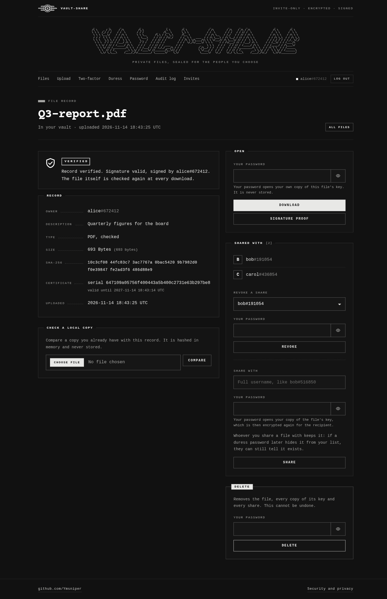

Every visit to a file's page checks its record and signature, and every
download checks the file itself. A record changed behind the app's back
shows up at once:

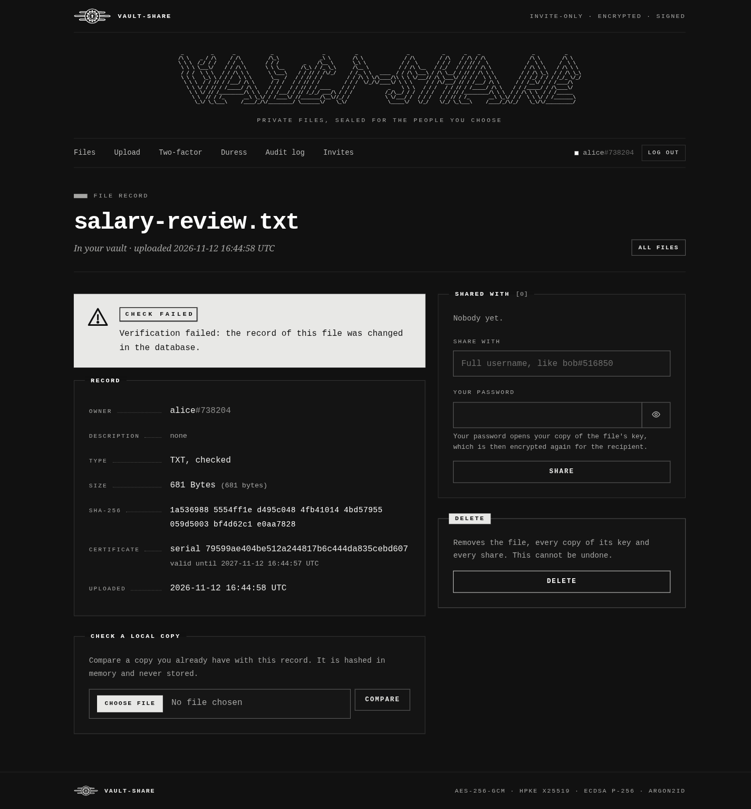

At login, five wrong passwords for one username from one address block
that pair for 15 minutes, and twenty from one address block the address;
an IPv6 address counts as its whole /48 network, since one subscriber can
switch among many.
Wrong tries from somewhere else never lock the owner out. Once logged in,
the password asked at upload, download, sharing and in the settings has a
limit of its own, five wrong ones per account, which only that account's
sessions can use up. Sharing with a username that does not exist counts
too, ten an hour, since each one is a guess at someone's tag. The counters
live in memory (Flask-Limiter), so restarting the app clears them. A
password check counts from the moment it starts, so requests sent at the
same time cannot all slip under a limit, and at most four checks run at
once: each one takes 64 MiB of memory.

Two-factor login is optional, per user, from the "Two-factor" page: scan
the QR code with an authenticator app such as Aegis or FreeOTP and confirm
with a first code. Wrong codes count toward the same limit as wrong
passwords, and each code works only once, even when two requests carry it
at the same moment. Until it is confirmed, the new secret stays on the
server with the session that asked for it: it never goes into the
browser's cookie, and another session of the account cannot see it. An
admin's new invite code is shown the same way, in the page that made it.

A duress password, set from the "Duress" page, is the one to give if someone
forces you to log in. It opens your account as if it were empty and writes a
silent alert to the audit log; with the wipe option it first destroys your
files, every file key copy made for you and your private keys, which nobody
can undo. With two-factor login on, the wipe waits for the code, like the
login itself, so a leaked duress password alone destroys nothing; the alert
is written as soon as the password is typed. Every account has a duress
slot, used or not, its mode is stored encrypted, and setting or removing
one is not logged, so neither the database nor the audit log shows who
set one. An admin's decoy session still shows the Audit log and Invites
pages, without the duress entries, but making or cancelling a code, like
changing a setting, answers that it could not be saved. Someone who tries
that every time may notice, and an admin who is the coercer sees the
alert.

The pages also work on a phone:

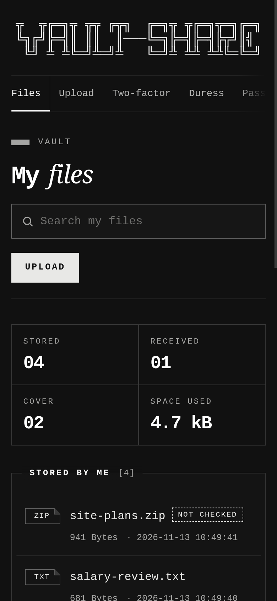

On first start the app creates two random keys in `instance/secrets/`:
`secret_key` signs the cookies and CSRF tokens, and `master.key` protects
the database itself, which SQLCipher keeps fully encrypted, along with the
file records' HMACs, the two-factor secrets and the duress settings. Back up
`master.key` separately from the database: without it the database cannot
be opened.

## Accounts and invite codes

Registering needs an invite code. Make them at the server, from the
console's Invites tab or the command line:

    vault-share invite new                         # with the defaults
    vault-share invite new --uses 30 --valid 2h    # a special code, for this one only
    vault-share invite list
    vault-share invite cancel 3                    # add --ban-accounts if it leaked
    vault-share invite defaults                    # show the defaults

By default a code lets one person register and works for 7 days. The
defaults change only at the server, with "Defaults..." in the console's
Invites tab or the command line, and only for codes made afterwards: every
code keeps the values it was made with.

    vault-share invite defaults --uses 2 --valid 3d --admin-per-day 6

A code lets 1 to 100 people register and works for 10 minutes to 90 days
(`30m`, `12h`, `7d`); the database refuses anything else, and every change
goes to the audit log. Only its SHA-256 is stored, so a copy of the
database gives nobody a code that works, and an unknown, used up, expired or
cancelled code all get the same answer. Each step of registering is limited
to ten tries an hour per address.

If a code leaks, `vault-share invite cancel 3 --ban-accounts` cancels it and
bans the accounts made with it, after listing them; "Cancel code" in the
console offers the same.

Usernames carry a tag: you pick a name and the server adds a random 6-digit
tag, so `bob` becomes something like `bob#516850`, and you log in and share
with all of it. Names can repeat, so the register page never says whether
one is taken, and knowing a username is not enough to lock its owner out
with wrong passwords. Registering takes two steps, the code and the name first,
then the password next to the full username, so the browser's password
manager saves the username with its tag. Quote it in a shell: `#` means
something to some shells.

<table>
  <tr>
    <td width="50%">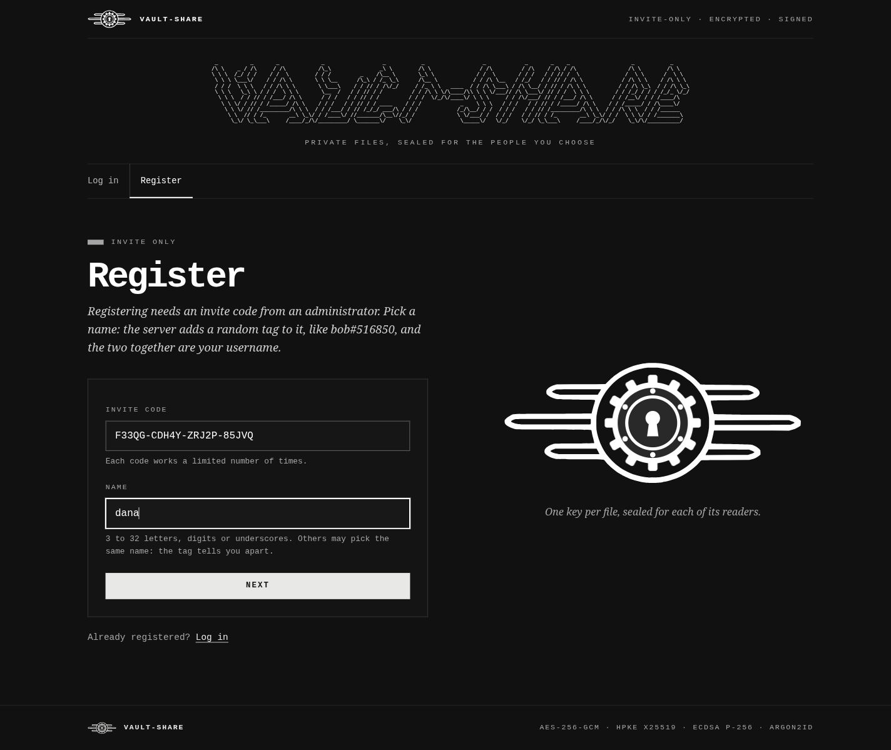 The invite code and a name</td>
    <td width="50%"> The password, next to the full username</td>
  </tr>
</table>

Admins can make codes too, on the "Invites" page, once their two-factor
login is on: each code asks for their password and a code from their phone.
Their codes get the defaults, and their daily limit counts the accounts
their codes can create, five by default, cancelled codes included. So a
stolen admin login can never let in more people than that, and
`--admin-per-day 0` stops admin codes altogether.

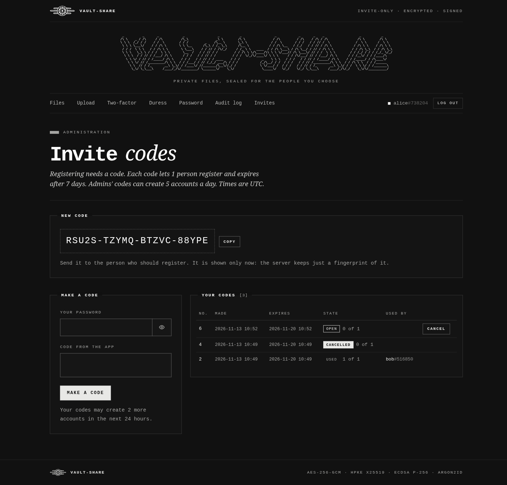

### Bans and cleanup

A ban locks an account out until it is lifted: it cannot log in, its
sessions end, its files disappear for everyone it shared them with, and it
loses its admin rights and open codes. Nothing is deleted, so an unban
gives everything back except the admin rights and the codes. Only the
server bans, from the console's Users tab or:

    vault-share admin ban 'bob#516850'
    vault-share admin unban 'bob#516850'

After an admin login is stolen, two commands undo what was done with it.
Both list what they will touch and ask before going ahead (`--yes` skips
the question). Times are in local time:

    # take the admin rights and cancel their open codes; also ban the
    # accounts their codes made since then, ban them, and revoke their certificate
    vault-share admin revoke-admin 'bob#516850' --ban-invited-since '2026-10-02 17:00' \
        --ban --revoke-certificate

    # ban the accounts created in a window and cancel the codes made in it,
    # from anyone's codes, one admin's (--admin) or the server's (--server)
    vault-share admin cleanup --from '2026-10-02 17:00' --to '2026-10-04 01:00'
    vault-share admin cleanup --from '2026-10-02 17:00' --to '2026-10-04 01:00' --unban

The console does the same with "Revoke admin..." in the Users tab and
"Clean up..." in the Invites tab. Revoking the certificate needs
`CA_PASSPHRASE`, like `admin revoke` below; with the stolen password, the
thief could sign files as the admin. The app has no password change, so the
real person gets a new account.

## File keys

The master key does not open files. Each file's key is stored only as
copies encrypted with HPKE (RFC 9180: X25519, HKDF-SHA256, AES-256-GCM), one
for each person who may open the file: its owner and every recipient of an
active share. Every user has an X25519 key pair for this, separate from
their signing key, and its private key is locked under a key derived from
their password with Argon2id. So even someone holding the whole server, keys
included, opens no file without the password of a person it was shared with.

That is why download and share ask for your password, like upload: it
unlocks your key for that one request, so a stolen session cookie alone
downloads nothing. Sharing opens your copy and encrypts the key again for
the recipient; revoking deletes their copy, so bringing the share back in
the database gives them nothing.

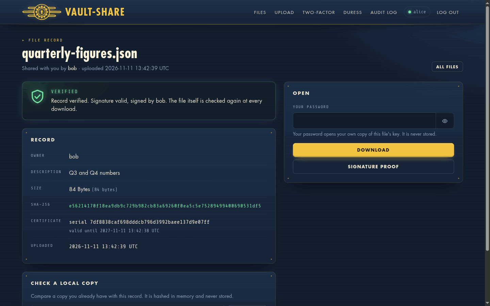

An archive shared with you comes with a warning:

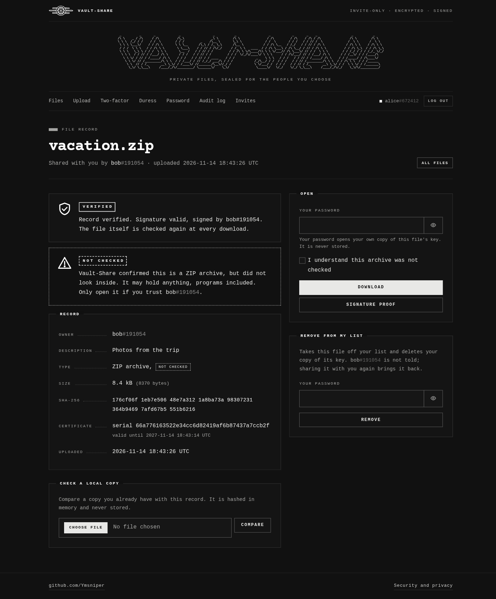

This is not end-to-end encryption. While a file is uploaded or downloaded
the server sees it, which is what lets it check uploads; a compromised
running server could keep what passes through it. The same library also
offers a post-quantum suite (`MLKEM768_X25519`) for a later upgrade.

## Server console

    vault-share                    # or: .venv/bin/python -m console

A terminal console (Textual) that runs the app and replaces most commands:
start and stop the server and watch its log, unlock it, see users and make
one an admin or revoke a certificate, read the audit log as it fills, add or
remove the USB stick and the passphrase, create the CA and the HTTPS
certificate, and reset the database. It uses the terminal's own colors.
Every action also stays available as a `flask --app app ...` command.

The lists keep their place while they update: the highlighted row and the
rows in view stay put as new entries arrive, and the server log only
follows new lines when you are at its bottom. In the Users, Invites and
Audit log tabs, `c` copies the highlighted row, and Enter (or a click on the
row already highlighted) opens it in a window whose text can be selected
and copied with Ctrl+C. Holding Shift while dragging selects any text on
screen in most terminals.

<table>
  <tr>
    <td width="50%">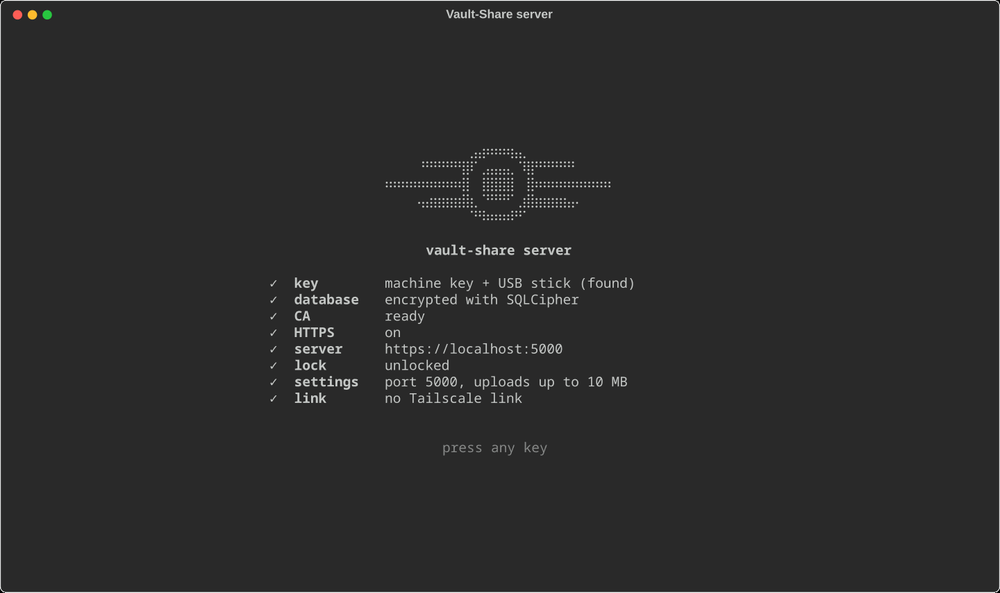 Startup checks</td>
    <td width="50%">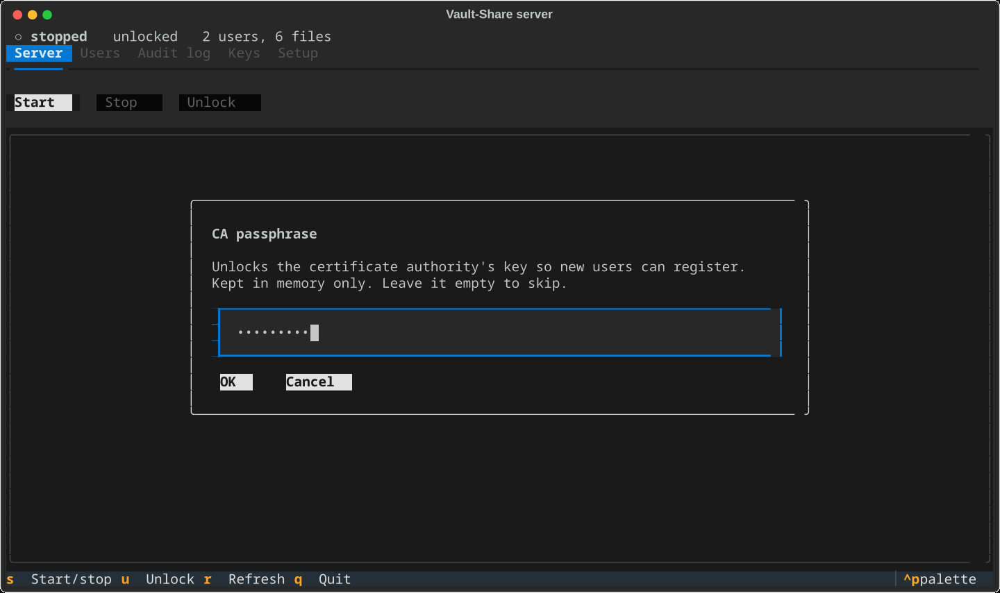 The CA passphrase, asked at startup and kept in memory</td>
  </tr>
  <tr>
    <td width="50%">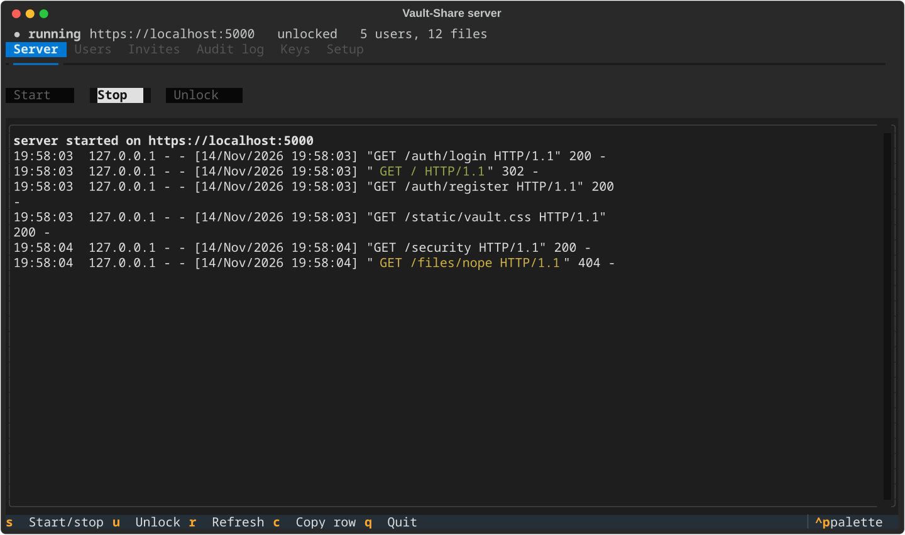 The server and its log</td>
    <td width="50%">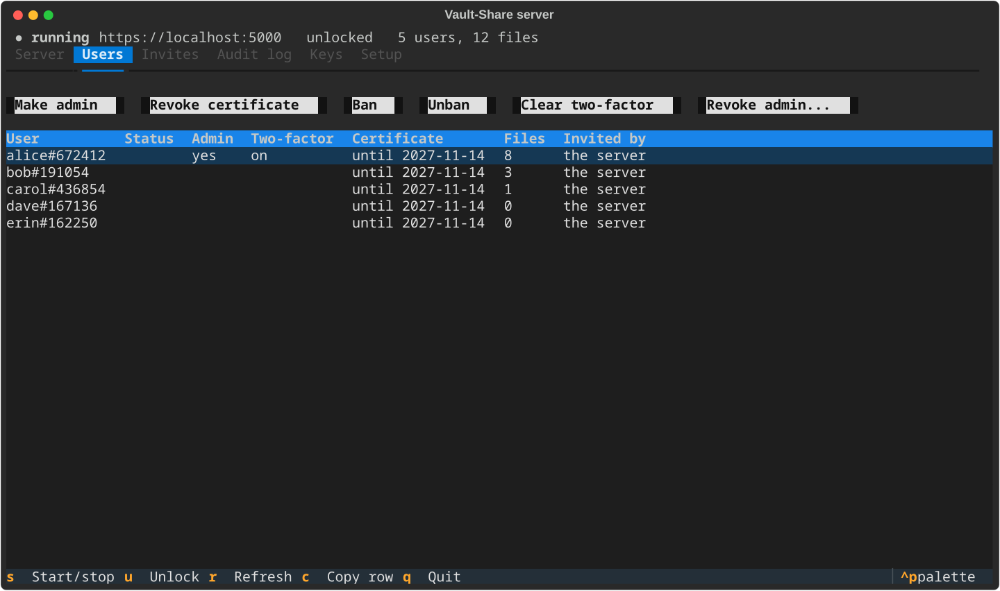 Users: make an admin, ban, revoke a certificate</td>
  </tr>
  <tr>
    <td width="50%">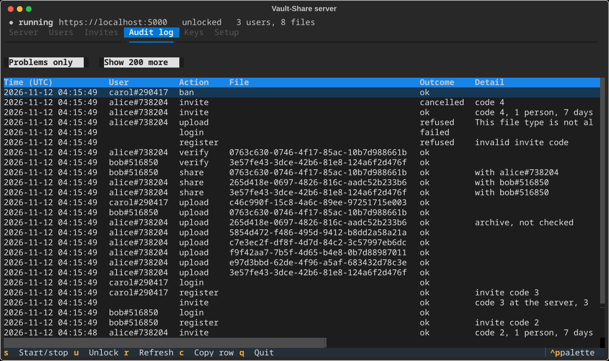 The audit log as it fills</td>
    <td width="50%"> Setup: the CA, its passphrase, the HTTPS certificate</td>
  </tr>
  <tr>
    <td width="50%">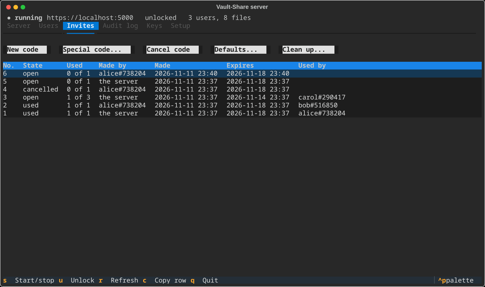 Invites: new and special codes, defaults, cleanup</td>
    <td width="50%">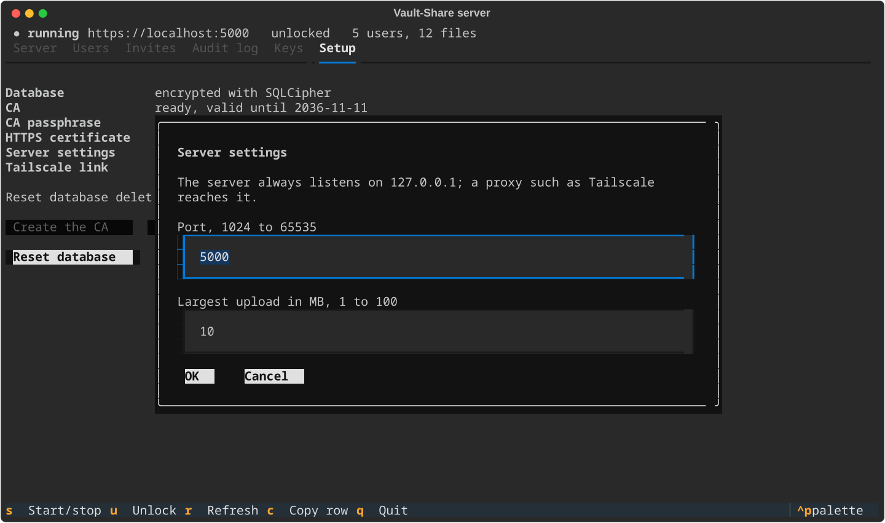 Server settings: the port and the upload limit</td>
  </tr>
</table>

## USB stick and passphrase

By default the master key is `instance/secrets/master.key` alone. It can
also need a USB stick, a passphrase, or both; it is then rebuilt from all of
them each time, so the disk, the stick or the passphrase alone opens
nothing. Stop the app before changing this:

    .venv/bin/flask --app app keys add-usb /run/media/$USER/STICK
    .venv/bin/flask --app app keys set-passphrase
    .venv/bin/flask --app app keys status

`add-usb` writes a random key file on the stick and prints a recovery code:
keep it on paper, away from the stick, since it replaces a lost stick
(`keys remove-usb` asks for it when the stick is missing). While `run.py`
runs, pulling the stick out locks the app within a second: the key is
dropped from memory, everyone is logged out and visitors only see "This
service is paused"; the reason goes to the server log. Plugging it back
unlocks it. With a passphrase, the operator types it at `/unlock` after
every start, or in the console. No page links there, and it answers only on
this machine: a visitor through a proxy, Tailscale Funnel included, gets
the paused page, and five wrong passphrases in 15 minutes block it for
everyone. Adding or removing a factor re-encrypts the database and
the record HMACs; file keys and the encrypted files are not touched, since
the master key does not protect them.

The console's Keys tab does the same without commands:

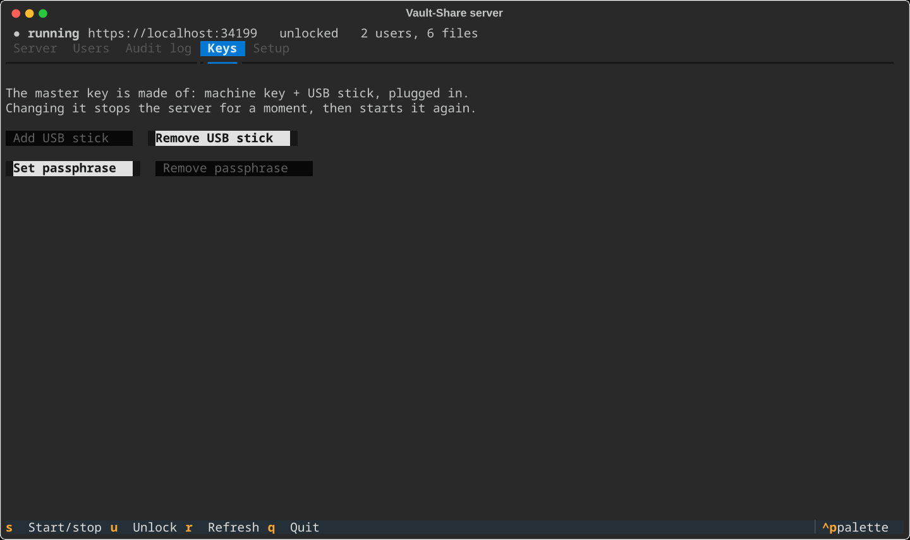

## HTTPS

    pki/create_server_cert.sh    # with CA_PASSPHRASE exported; again to renew
    .venv/bin/python run.py      # now https://localhost:5000

`run.py` serves HTTPS as soon as `instance/tls/server.crt` exists. The app
then redirects plain HTTP to HTTPS and marks the cookies Secure, through
Flask-Talisman, which also sets the Content-Security-Policy and the other
security headers. Browsers warn
until they trust the local CA: import `instance/ca/ca.crt` as a certificate
authority (in Firefox: Settings, Privacy & Security, View Certificates,
Authorities, Import). To look at the certificate chain from a terminal:

    openssl s_client -connect localhost:5000 -CAfile instance/ca/ca.crt

## A public link

The app only listens on localhost. Tailscale Funnel can give this machine a
public HTTPS address with a real certificate; the visitor's encrypted
connection still ends on this machine, Tailscale only relays it. With
Tailscale installed and logged in:

    tailscale funnel --bg https+insecure://127.0.0.1:5000    # or your port
    BEHIND_PROXY=1 vault-share

`https+insecure` lets Tailscale accept the certificate from the local CA,
fine for a connection that never leaves the machine. Behind the proxy every
request comes from 127.0.0.1, so `BEHIND_PROXY=1` makes the app take the
visitor's address from the X-Forwarded-For header Tailscale adds; the rate
limits and the audit log need it. Leave it unset when nothing sits in front
of the app, or clients could pick their own address. `tailscale funnel
status` shows the address and `tailscale funnel reset` takes it down.

Registering needs an invite code, so strangers cannot sign up, but the
login page is public and certificates are published, so new addresses get
found quickly: keep the link up only while it is needed.

## Server settings

The port and the upload limit are set at the server, in
`instance/server.toml`, from "Server settings..." in the console's Setup
tab or the command line:

    vault-share server-settings                              # show them
    vault-share server-settings --port 5101 --max-upload-mb 50

The port goes from 1024 to 65535 (5000 by default) and the upload limit
from 1 to 100 MB (10 by default): a file is held in memory while it is
hashed, encrypted and signed, so a higher ceiling would let a few uploads
use up the memory. A file with wrong values is ignored, with a warning, and
the defaults are used. The server always listens on 127.0.0.1, which is not
a setting: from elsewhere it is reached through a proxy. The console uses a
new port at once; `vault-share serve` when it starts again.

When the port changes and a Tailscale link (Funnel or serve) still points at
the old one, the console and `server-settings` ask whether to move it, and
do it on yes (`--yes` answers for the command). Only the rules that pointed
at the old port on this machine change; a public link stays public, a
tailnet one stays private, and nothing is turned on. The console's startup
screen and Setup tab say where the link points.

## Admin

To make a user an admin, who can read the audit log and make invite codes:

    .venv/bin/flask --app app admin grant '<username>'

The audit log shows 200 events at a time, with a link to older ones, and
can show only the problems: failures, refusals, locks and the duress alert.
The console's Audit log tab has the same filter and shows 200 more rows at a
time. So a user who fills the log cannot push an entry out of reach, and an
owner's own visits to their file pages are not logged at all.

To revoke a user's certificate, for example after their key leaked:

    .venv/bin/flask --app app admin revoke '<username>'

This needs `CA_PASSPHRASE`: it also writes `instance/ca/crl.pem`, a
revocation list signed by the CA. Files signed with the revoked certificate
stop passing verification, and the user's next upload gives them a new key
and certificate. Expiry is different: a certificate lasts a year, and a
file is judged by whether it was valid at its upload time, which the
record HMAC covers, so files keep verifying after it expires. OpenSSL can
check a certificate against the list:

    openssl verify -crl_check -CAfile instance/ca/ca.crt -CRLfile instance/ca/crl.pem <certificate>

## Known limits

- The server is Werkzeug's development server, with each TLS handshake in
  its connection's own thread. It starts one thread per connection, without
  a cap; Argon2, the part that needs memory, runs at most four at once.
- Public encryption keys are read from the database, not certified by the
  CA: someone holding the master key could swap a user's public key and
  receive the next file shared with them.
- The record HMAC does not cover a file's name and description, so those
  could be changed in the database without the check noticing.
- There is no password change: a leaked password stays valid until the
  account is banned.

## Tests

    .venv/bin/pytest

`hooks/pre-commit` runs the local checks: bandit (a security linter), the
tests, and pip-audit (known vulnerabilities in the pinned dependencies,
needs the internet) when a requirements file is part of the commit. Run it
by hand, or have git run it before every commit:

    git config core.hooksPath hooks
