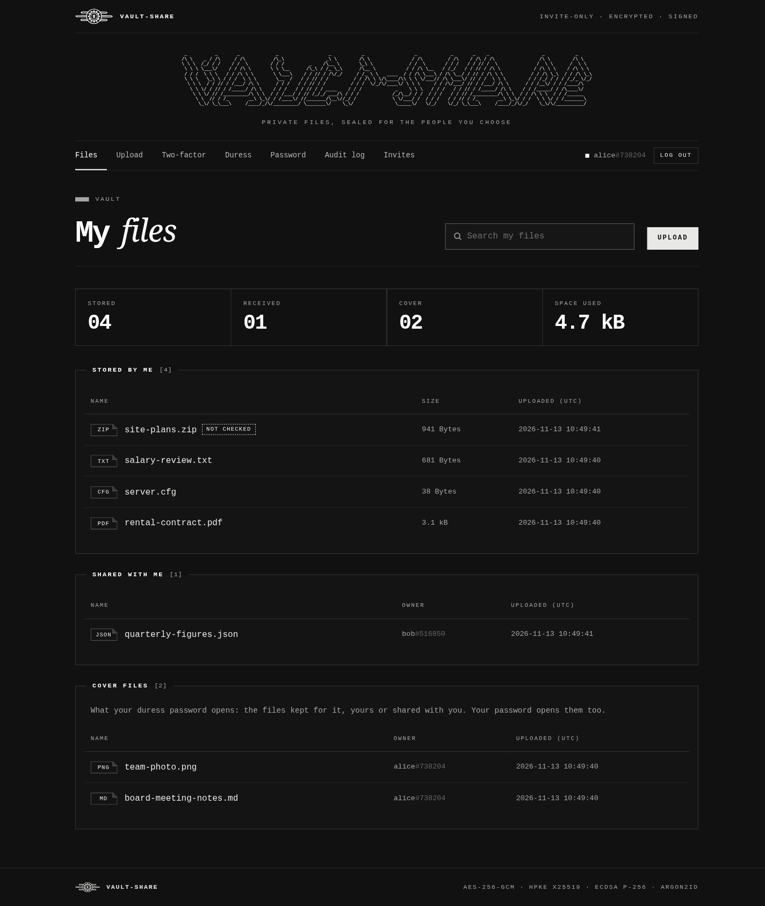
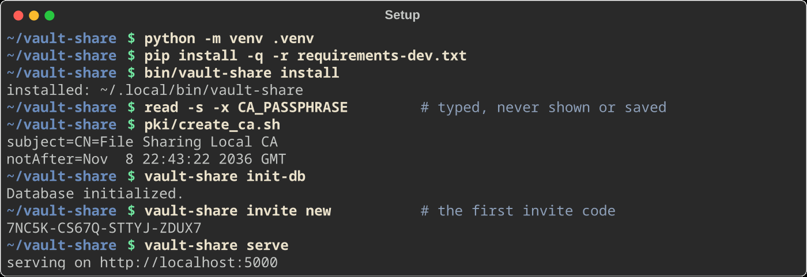
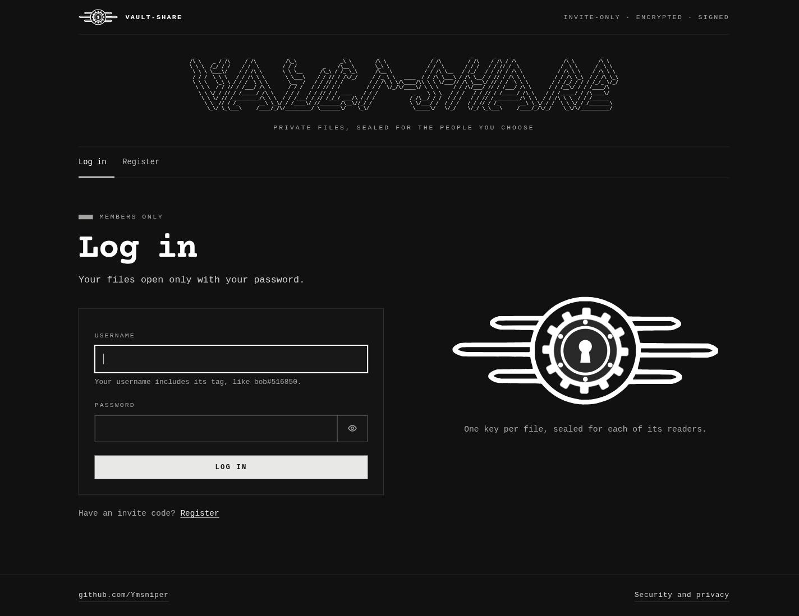
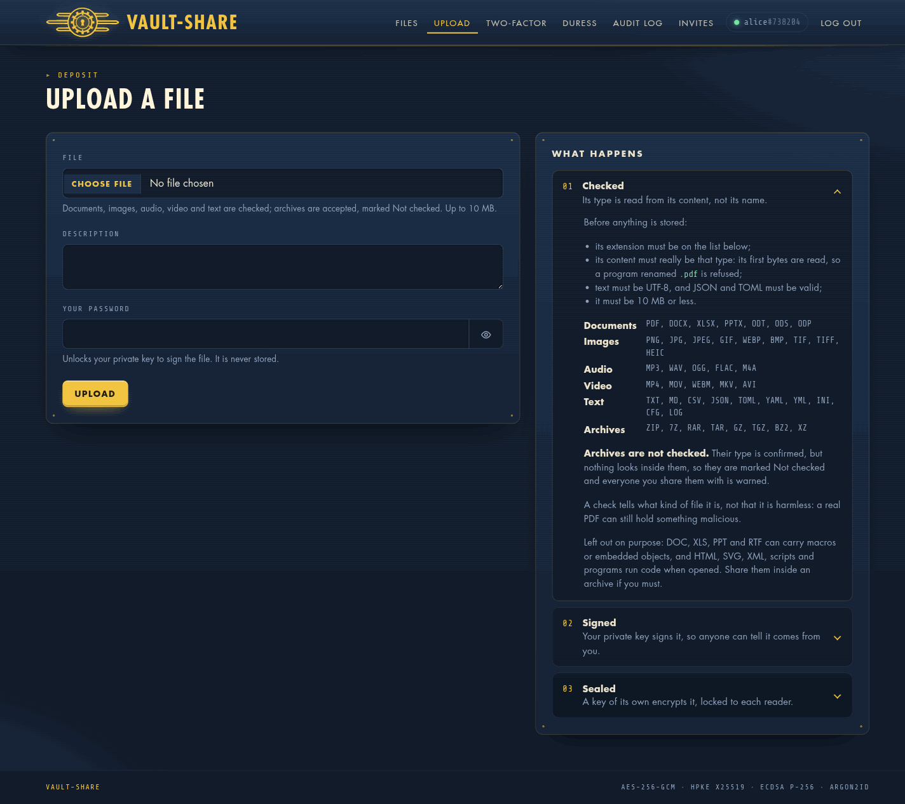
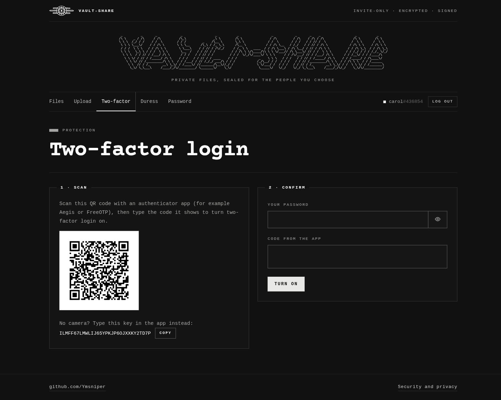
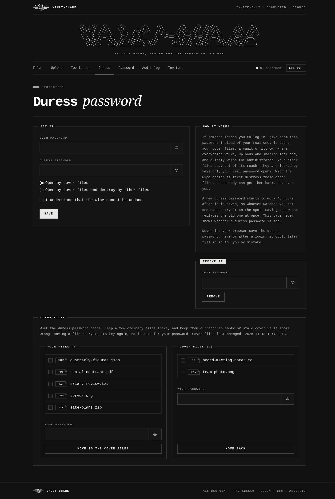
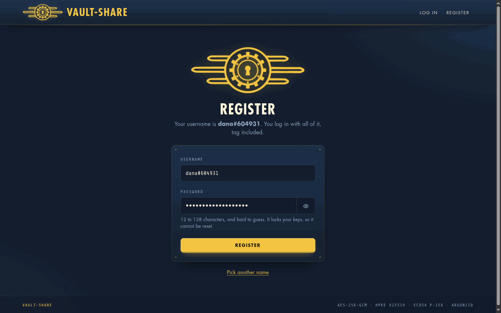
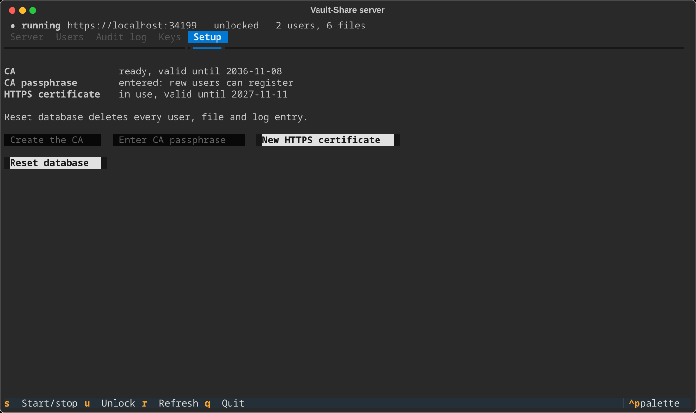
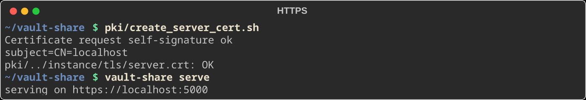
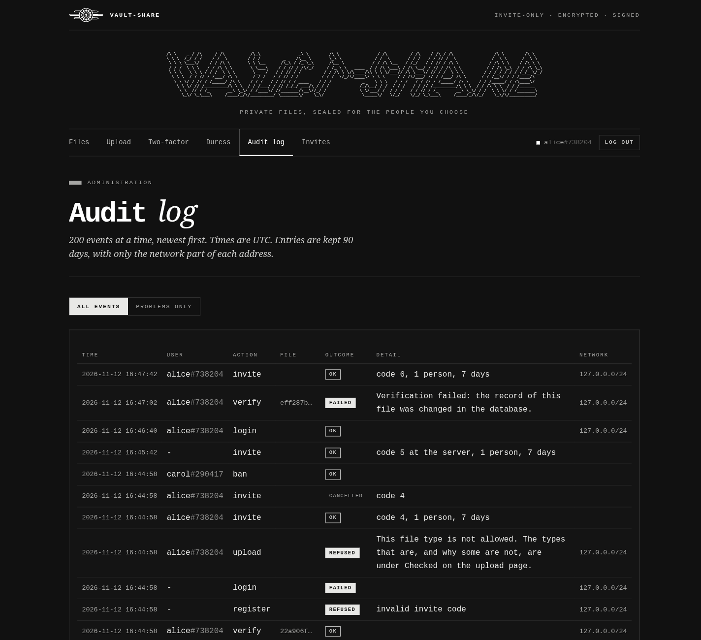

# Vault-Share

Secure file sharing: a Flask web app for sharing confidential files between
users. Each file is encrypted at rest with its own AES-256-GCM key, kept
only as copies encrypted to the public key of each person allowed to open
it, checked with SHA-256 and an HMAC, and signed with an ECDSA key certified
by a local CA.

<!-- The pictures live in docs/screenshots/; replace a file there to update it here. -->

## Features

- Every file has its own AES-256-GCM key, stored only as copies encrypted
  with HPKE (X25519) for its owner and each person it is shared with: the
  server's own keys cannot open a stored file.
- Files are signed with ECDSA P-256 keys certified by a local OpenSSL CA,
  with revocation and a signature proof that can be checked offline.
- Uploads are checked by their content, not their name. Archives are
  accepted but marked Not checked for everyone they are shared with.
- The database is encrypted with SQLCipher, and every file record is
  protected by an HMAC.
- Argon2id passwords, server-side sessions, CSRF protection, rate limits,
  security headers and optional two-factor login.
- Registering needs an invite code, and every username gets a random tag.
  Bans and a cleanup by inviter and time window undo what a stolen admin
  login let in.
- A duress password that opens a cover vault of its own, kept apart by
  keys, and can wipe the rest.
- The master key can also require a USB stick and a passphrase; pulling the
  stick locks the service.
- A terminal console to run and manage the server.
- A black-and-white interface in typewriter type, with an ASCII-art wordmark.

## Run

    python -m venv .venv
    .venv/bin/pip install -r requirements-dev.txt
    bin/vault-share install        # the `vault-share` command, from any terminal
    read -s -x CA_PASSPHRASE       # fish; in bash: read -rs CA_PASSPHRASE && export CA_PASSPHRASE
    pki/create_ca.sh
    vault-share init-db
    vault-share                    # the console; `vault-share serve` runs the server alone

`read -s` asks for the CA passphrase without showing it and without saving
it in the shell history, which `export CA_PASSPHRASE='...'` would do. The
console asks for it itself at startup when it is not set, and keeps it in
memory only. `vault-share` passes anything else to `flask --app app`, so
`vault-share keys status` or `vault-share admin grant 'bob#516850'` work
from any folder; `vault-share install` links the command into
`~/.local/bin`.

Then open http://127.0.0.1:5000 (the port can change, see "Server settings"
below). `pki/create_ca.sh` creates the local CA in
`instance/ca/` once; the app needs the same `CA_PASSPHRASE` every time it
starts, to issue a certificate to each new user. Registering needs an invite
code: make the first one with `vault-share invite new` (see below).

## Using it

Uploading asks for your password again: it unlocks your private key to sign
the file. Each file's record carries an HMAC over all of its fields, from
the owner and the hash to the name, the description and the signature, so a
record edited in the database fails its check on the file page. Each file
page also offers a signature proof, a zip with the
signature, the signer's certificate, the CA certificate and the OpenSSL
commands that check the file without the app. They check the certificate
as it was at the upload time, and name your copy FILE rather than using
the file's name, which could hold shell syntax.

Every upload is checked before it is stored: its extension must be on the
list, its content must really be that type (`filetype` reads the first
bytes, so a program renamed `.pdf` is refused; text must be UTF-8, and JSON
and TOML must be valid), and it must fit under the upload limit.

- Documents: PDF, DOCX, XLSX, PPTX, ODT, ODS, ODP
- Images: PNG, JPG, GIF, WEBP, BMP, TIFF, HEIC
- Audio: MP3, WAV, OGG, FLAC, M4A
- Video: MP4, MOV, WEBM, MKV, AVI
- Text: TXT, MD, CSV, JSON, TOML, YAML, INI, CFG, LOG

Archives (ZIP, 7Z, RAR, TAR, GZ, TGZ, BZ2, XZ) are accepted too: their
signature is checked, so a program renamed `.zip` is refused, but not what
they hold. They are marked Not checked, and the HMAC of the file's record
covers that mark, so it cannot be dropped in the database. Everyone they are
shared with sees a warning, and must tick "I understand" before downloading.
DOC, XLS, PPT and RTF (macros, embedded objects), and HTML, SVG, XML,
scripts and programs (they run code when opened) are left out; share them
inside an archive. A check tells what kind of file it is, not that it is
harmless. The upload page explains all of this under "What happens".

Every visit to a file's page checks its record and signature, and every
download checks the file itself. A record changed behind the app's back
shows up at once:

At login, five wrong passwords for one username from one address block
that pair for 15 minutes, and twenty from one address block the address;
an IPv6 address counts as its whole /48 network, since one subscriber can
switch among many. A browser that logged in as someone keeps a signed
cookie for a year that says so, holding a keyed digest rather than the
name; browsers without it share fifty wrong tries an hour per username,
wherever they come from, so many addresses together get about 1,200
guesses a day at one account instead of no limit at all.
Wrong tries from somewhere else never lock the owner out of a browser they
have logged in from before; during such an attack, a browser they never
used has to wait for the hour to pass. Once logged in,
the password asked at upload, download, sharing, revoking, deleting and in
the settings has a limit of its own, five wrong ones per account, which only that account's
sessions can use up. Sharing with a username that does not exist counts
too, ten an hour, since each one is a guess at someone's tag. The counters
live in memory (Flask-Limiter), so restarting the app clears them. A
password check counts from the moment it starts, so requests sent at the
same time cannot all slip under a limit: one that finds the limit filled by
checks still running waits up to 10 seconds for them, and is refused only
if they failed. Right passwords count too, sixty checks in 15 minutes per
account, and at most four checks run at once: each one takes 64 MiB of
memory.

Two-factor login is optional, per user, from the "Two-factor" page: scan
the QR code with an authenticator app such as Aegis or FreeOTP and confirm
with a first code. Wrong codes count toward the same limit as wrong
passwords, and each code works only once, even when two requests carry it
at the same moment. Turning it on also gives ten recovery codes, shown once
in that page: each one logs in once instead of a code from the phone, and
"New codes" replaces them. Someone who lost both the phone and the codes
asks the operator, who can turn their two-factor login off with
`vault-share admin clear-totp '<username>'` or "Clear two-factor" in the
console's Users tab. Until it is confirmed, the new secret stays on the
server with the session that asked for it: it never goes into the
browser's cookie, and another session of the account cannot see it. An
admin's new invite code is shown the same way, in the page that made it.

A duress password, set from the "Duress" page, is the one to give if someone
forces you to log in. It opens your cover files: a second vault that is
real, where uploads, downloads, sharing and the settings all work, rather
than an empty account that refuses things. What keeps your other files from
it is keys, not hidden buttons. Every account has eight levels, each with
its own X25519 key pair: the real password opens level 0, the duress
password level 1, and each level after it, down to level 7, opens with the
duress password set from a session at the level above. A level's private
key is locked under its password and also linked down from the level
above, so a password opens its own level and the ones below it, never the
one above. Each password typed costs one Argon2id run (9
passes over 64 MiB) with the account's salt, and every check and key of it
comes from that run: a credential row keeps an HMAC of it, and the level's
lock is made with a key derived from it. A login costs one run whatever it
opens and however many levels there are. The account's passwords share the
salt, so one offline guess tests them all at once; the run, three times as
strong as each of the three checks it replaced, pays for that. One more key
pair, linked down from level 7's and opened by no password, keeps level 7's
cover files. Opening a session's keys always takes as many steps: after the
real links down from its level, the rest go through a spare pair made at
start-up, so a request at level 0 does the same work as one at level 7.
Every session believes it is the top: it sees its own files, and the
levels below it as its cover files, and every page looks the same at
each level. A password asked inside a session is checked against that
session's level only, so no form there can test another password. The
signing key hangs off level 7, which every password reaches, so files
uploaded at any level carry the same certificate. The Duress page moves
files between your own vault and the cover files, yours or shared with you:
each move encrypts the key copy again to the other level's public key, so it
asks for the password, and it is not logged. Moves go one level at a time: a
file a duress session moved further down shows among your cover files and
opens, but only that session's level moves it back. A file shared again
stays where its recipient keeps it, deeper if a duress window brings it
down, so a share never takes a file out of the cover files. The page also
shows when the cover files last changed, since an empty or stale cover vault
looks wrong.

A duress login opens its level's window, which stays open until a login at a
lower level number closes it. Meanwhile shares sent to the account arrive at
that level, so whoever holds the duress session sees them arrive as on a
real account, and files a duress session deletes are trashed instead of
destroyed: hidden from everyone, recipients included, as if they were gone,
and kept for the real owner. A file a duress session takes off its list is
kept the same way, for the owner to put back. The real password deletes and
dismisses for good. The login that closes a window owes a review of what
happened in it, and every login with that password goes to the review, its
other sessions linking to it, until the owner says done: through a logout, a
timeout or months away. The review shows the duress logins, what was done,
the files deleted (which it can restore), taken off the list (which it can
put back), uploaded (which it can delete) or shared with the account
meanwhile (which it can bring back to its own files), and the command the
operator runs to revoke the certificate from the time the window opened,
since whoever held the duress password could sign in the user's name. It
says plainly that whoever holds the duress password can log in with it
again and will see what is shared from then on, and offers to keep it or
to replace it there. What it does shows in the duress vault, and the page
says so. Deleted and removed files are kept 30 days from when the review
first shows them, so an owner who never logs in loses nothing; "Done"
restores what is left or lets it go.
A duress session that closes the window of a level below its own gets the
same review: every level looks like the top.

A duress login is the silent alarm: its login row is written at its level,
and the console shows it as `duress`. So does every admin session, at any
level, for another account's duress logins and for its own account's logins
at a level below its own; at the duress level itself it is a plain login. A
duress admin session thus shows the alarms a real one would, other people's
included: hiding them would give it away to anyone who set a duress password
on an account of their own. The web log shows security events only, with no
file activity and no invite code numbers (see Admin below), so a cover file
cannot lack its upload row there. An admin's session at level 1 sees it
without the rows its account wrote at level 0, and the invites page lists
and counts only the codes made at its level or below. With the wipe option,
the duress password destroys the files and key copies of the level that set
it, at once, and nothing else: the keys stay, so the levels below keep
working. Files shared with it leave its list as after a dismiss, so their
senders see nothing change, and when a duress session armed the wipe, the
review can put them back. With two-factor login on, the wipe waits for the
code, like the login itself, so a leaked duress password alone destroys
nothing; the alarm is written as soon as the password is typed. A new
duress password starts to work 48 hours after it is
saved, at every level alike, so whoever watches one being set cannot try it
on the spot. The one it replaces keeps working until then, so its holder
notices nothing before: each duress level has two credential rows, the
password in use and the next one, and the next one takes over at the first
request or login after its time. Only then are the passwords set further
down cleared, as a removal clears them at once, so a password a coercer set
from a duress session does not outlive it; the sessions the old password
opened end, and two-factor login at that level and below starts afresh.
Every account has all eight levels from the start, with 17 credential rows
of the same lengths, two of them for the password saved at the last level,
so a level without a password looks like one with a password in the
database; the record of which is which is sealed under the master key, and
setting or removing a duress password is not logged. The "Password" page
changes the password a session logged in with, at its own level only: it
locks that level's key again under the new password, so every file still
opens and nothing needs encrypting again, and it ends the account's other
sessions at that level and below. A new password may not be a duress
password of a level below, in use or still to come, which would then open
the upper one. A forgotten password still cannot be reset: it is the only
way to its keys.

Two-factor login is kept per level, as passwords are: each level has it on,
off, or as the level above it does, which is where every duress level
starts. A session that turns it on or off, or asks for new recovery codes,
changes it for its own password only, so a duress session cannot lock the
real password out, and the page looks the same at every level. A level that
inherits the secret shares the record of the last code used, so one code
never opens two sessions; one with codes of its own takes only those. The
operator's `admin clear-totp` resets every level of the account.

What the levels cannot hide:

- The real password: a keylogger, or a password stolen earlier, ends all of
  this.
- The server and an admin working with the coercer: the database and the
  log show that levels are in use, though not what the files hold.
- A file shared with the accomplice earlier: they keep it, and it is
  missing from the duress vault. The share form says so; keep files shared
  with people you do not fully trust among the cover files.
- An unconvincing cover vault: empty or stale cover files give it away,
  which is why the Duress page shows when they last changed.
- The bottom: no password opens anything below level 7, so a duress
  password set from a level 7 session opens nothing, though the pages
  there answer as at the levels above. Getting there takes seven 48-hour
  delays and eight logins, 14 days at the least.
- Honest senders: a file shared with the account while a duress window is
  open is readable by whoever holds the duress session. The alarm is there
  so that admins can act in that time.
- A coercer who knows this design: they know any account may have a higher
  level, and can never prove it has none.
- An admin's earlier logins: a duress admin session's log shows none of
  its account's logins from before it, a soft tell for admin accounts only.
- A used duress password: it keeps working, and every later login with it
  opens a new window, so files shared with the account from then on reach
  whoever holds it. Ending it on its own would give the owner away, so it
  ends only when the owner replaces it, 48 hours after the new one is
  saved, or removes it, and whoever holds it then notices.
- The first 48 hours: a first duress password does not work yet, so a
  login forced in that time has only the real password to give.
- The invite allowance: each level counts only the codes made at its own
  level or below, since a shared count would show a duress session that
  codes exist above it. An admin who knows their own duress passwords can
  make a day's allowance at each level, and so can a coercer in an admin's
  duress session; the cleanup by inviter and time window undoes it.

The pages also work on a phone:

On first start the app creates two random keys in `instance/secrets/`:
`secret_key` signs the cookies and CSRF tokens, and `master.key` protects
the database itself, which SQLCipher keeps fully encrypted, along with the
file records' HMACs, the two-factor secrets and the duress settings. Back up
`master.key` separately from the database: without it the database cannot
be opened.

## Accounts and invite codes

Registering needs an invite code. Make them at the server, from the
console's Invites tab or the command line:

    vault-share invite new                         # with the defaults
    vault-share invite new --uses 30 --valid 2h    # a special code, for this one only
    vault-share invite list
    vault-share invite cancel 3                    # add --ban-accounts if it leaked
    vault-share invite defaults                    # show the defaults

By default a code lets one person register and works for 7 days. The
defaults change only at the server, with "Defaults..." in the console's
Invites tab or the command line, and only for codes made afterwards: every
code keeps the values it was made with.

    vault-share invite defaults --uses 2 --valid 3d --admin-per-day 6

A code lets 1 to 100 people register and works for 10 minutes to 90 days
(`30m`, `12h`, `7d`); the database refuses anything else, and every change
goes to the audit log. Only its SHA-256 is stored, so a copy of the
database gives nobody a code that works, and an unknown, used up, expired or
cancelled code all get the same answer. Each step of registering is limited
to ten tries an hour per address.

If a code leaks, `vault-share invite cancel 3 --ban-accounts` cancels it and
bans the accounts made with it, after listing them; "Cancel code" in the
console offers the same.

Usernames carry a tag: you pick a name and the server adds a random 6-digit
tag, so `bob` becomes something like `bob#516850`, and you log in and share
with all of it. Names can repeat, so the register page never says whether
one is taken, and knowing a username is not enough to lock its owner out
with wrong passwords. Registering takes two steps, the code and the name first,
then the password next to the full username, so the browser's password
manager saves the username with its tag. Quote it in a shell: `#` means
something to some shells.

<table>
  <tr>
    <td width="50%"> The invite code and a name</td>
    <td width="50%"> The password, next to the full username</td>
  </tr>
</table>

Admins can make codes too, on the "Invites" page, once their two-factor
login is on: each code asks for their password and a code from their phone.
Their codes get the defaults, and their daily limit counts the accounts
their codes can create, five by default, cancelled codes included. So a
stolen admin login can never let in more people than that, and
`--admin-per-day 0` stops admin codes altogether.

### Bans and cleanup

A ban locks an account out until it is lifted: it cannot log in, its
sessions end, its files disappear for everyone it shared them with, and it
loses its admin rights and open codes. Nothing is deleted, so an unban
gives everything back except the admin rights and the codes. Only the
server bans, from the console's Users tab or:

    vault-share admin ban 'bob#516850'
    vault-share admin unban 'bob#516850'

After an admin login is stolen, two commands undo what was done with it.
Both list what they will touch and ask before going ahead (`--yes` skips
the question). Times are in local time:

    # take the admin rights and cancel their open codes; also ban the
    # accounts their codes made since then, ban them, and revoke their
    # certificate for the files uploaded since then
    vault-share admin revoke-admin 'bob#516850' --ban-invited-since '2026-10-02 17:00' \
        --ban --revoke-since '2026-10-02 17:00'

    # ban the accounts created in a window and cancel the codes made in it,
    # from anyone's codes, one admin's (--admin) or the server's (--server)
    vault-share admin cleanup --from '2026-10-02 17:00' --to '2026-10-04 01:00'
    vault-share admin cleanup --from '2026-10-02 17:00' --to '2026-10-04 01:00' --unban

The console does the same with "Revoke admin..." in the Users tab and
"Clean up..." in the Invites tab; there the certificate is revoked from the
time typed for the accounts, if one was. Revoking the certificate needs
`CA_PASSPHRASE`, like `admin revoke` below; with the stolen password, the
thief could sign files as the admin (`--revoke-certificate` alone revokes
it from now on). The app has no password change, so the
real person gets a new account.

## File keys

The master key does not open files. Each file's key is stored only as
copies encrypted with HPKE (RFC 9180: X25519, HKDF-SHA256, AES-256-GCM), one
for each person who may open the file: its owner and every recipient of an
active share. Every user has an X25519 key pair for each of their eight
levels, and one for level 7's cover files (see the duress password above),
separate from their signing key, and each level's private key is locked
under a key derived from that level's password through its Argon2id run. A
copy is bound to one file, one reader and one level. So even someone
holding the whole server, keys included, opens no file without the
password of a person it was shared with.

That is why download and share ask for your password, like upload: it
unlocks your key for that one request, so a stolen session cookie alone
downloads nothing. Sharing opens your copy and encrypts the key again for
the recipient; revoking deletes their copy, so bringing the share back in
the database gives them nothing. Revoking and deleting ask for the password
too, so a stolen cookie cannot destroy files or cut anyone off either.
A recipient can also take a shared file off their own list ("Remove from
my list", with the password): their copy of the key goes, the owner is not
told and still sees the share, and sharing it again brings it back. It is
not logged, so a file missing from someone's list can always have been
removed this way, which is also what a duress session's view looks like.

An archive shared with you comes with a warning:

This is not end-to-end encryption. While a file is uploaded or downloaded
the server sees it, which is what lets it check uploads; a compromised
running server could keep what passes through it. The same library also
offers a post-quantum suite (`MLKEM768_X25519`) for a later upgrade.

## Server console

    vault-share                    # or: .venv/bin/python -m console

A terminal console (Textual) that runs the app and replaces most commands:
start and stop the server and watch its log, unlock it, see users and make
one an admin or revoke a certificate, read the audit log as it fills, add or
remove the USB stick and the passphrase, create the CA and the HTTPS
certificate, and reset the database. It uses the terminal's own colors.
Every action also stays available as a `flask --app app ...` command.

The database records the version of its tables, and the code checks it
once the app is unlocked. After an update that changed the tables, the
console says so with the unlock and stays open, so that Setup > Reset
database can be used; `vault-share serve` prints the same message and
stops, other commands print it, and visitors see the paused page. If the
console ever crashes, its report leaves out the values of variables, so a
passphrase typed into it is not printed.

The lists keep their place while they update: the highlighted row and the
rows in view stay put as new entries arrive, and the server log only
follows new lines when you are at its bottom. In the Users, Invites and
Audit log tabs, `c` copies the highlighted row, and Enter (or a click on the
row already highlighted) opens it in a window whose text can be selected
and copied with Ctrl+C. Holding Shift while dragging selects any text on
screen in most terminals.

<table>
  <tr>
    <td width="50%"> Startup checks</td>
    <td width="50%"> The CA passphrase, asked at startup and kept in memory</td>
  </tr>
  <tr>
    <td width="50%"> The server and its log</td>
    <td width="50%"> Users: make an admin, ban, revoke a certificate</td>
  </tr>
  <tr>
    <td width="50%"> The audit log as it fills</td>
    <td width="50%"> Setup: the CA, its passphrase, the HTTPS certificate</td>
  </tr>
  <tr>
    <td width="50%"> Invites: new and special codes, defaults, cleanup</td>
    <td width="50%"> Server settings: the port and the upload limit</td>
  </tr>
</table>

## USB stick and passphrase

By default the master key is `instance/secrets/master.key` alone. It can
also need a USB stick, a passphrase, or both; it is then rebuilt from all of
them each time, so the disk, the stick or the passphrase alone opens
nothing. Stop the app before changing this:

    .venv/bin/flask --app app keys add-usb /run/media/$USER/STICK
    .venv/bin/flask --app app keys set-passphrase
    .venv/bin/flask --app app keys status

`add-usb` writes a random key file on the stick and prints a recovery code:
keep it on paper, away from the stick, since it replaces a lost stick
(`keys remove-usb` asks for it when the stick is missing). While `run.py`
runs, pulling the stick out locks the app within a second: the key is
dropped from memory, everyone is logged out and visitors only see "This
service is paused"; the reason goes to the server log. Plugging it back
unlocks it. With a passphrase, the operator types it after every start,
and when the stick comes back, in the console ("Unlock") or in the terminal
running `vault-share serve`. There is no unlock page: nobody who reaches
the app over the network, through any proxy, can try a passphrase, or
block the right one with wrong guesses. Without a terminal, `vault-share
serve` cannot ask and stays locked, so run it in one or use the console.
Adding or removing a factor re-encrypts the database and
the record HMACs; file keys and the encrypted files are not touched, since
the master key does not protect them.

The console's Keys tab does the same without commands:

## HTTPS

    pki/create_server_cert.sh    # with CA_PASSPHRASE exported; again to renew
    .venv/bin/python run.py      # now https://localhost:5000

`run.py` serves HTTPS as soon as `instance/tls/server.crt` exists. The app
then redirects plain HTTP to HTTPS and marks the cookies Secure, through
Flask-Talisman, which also sets the Content-Security-Policy and the other
security headers. Browsers warn
until they trust the local CA: import `instance/ca/ca.crt` as a certificate
authority (in Firefox: Settings, Privacy & Security, View Certificates,
Authorities, Import). To look at the certificate chain from a terminal:

    openssl s_client -connect localhost:5000 -CAfile instance/ca/ca.crt

## A public link

The app only listens on localhost. Tailscale Funnel can give this machine a
public HTTPS address with a real certificate; the visitor's encrypted
connection still ends on this machine, Tailscale only relays it. With
Tailscale installed and logged in:

    tailscale funnel --bg https+insecure://127.0.0.1:5000    # or your port
    BEHIND_PROXY=1 vault-share

`https+insecure` lets Tailscale accept the certificate from the local CA,
fine for a connection that never leaves the machine. Behind the proxy every
request comes from 127.0.0.1, so `BEHIND_PROXY=1` makes the app take the
visitor's address from the X-Forwarded-For header Tailscale adds; the rate
limits and the audit log need it. Leave it unset when nothing sits in front
of the app, or clients could pick their own address. `tailscale funnel
status` shows the address and `tailscale funnel reset` takes it down.

Registering needs an invite code, so strangers cannot sign up, but the
login page is public and certificates are published, so new addresses get
found quickly: keep the link up only while it is needed.

## Server settings

The port and the upload limit are set at the server, in
`instance/server.toml`, from "Server settings..." in the console's Setup
tab or the command line:

    vault-share server-settings                              # show them
    vault-share server-settings --port 5101 --max-upload-mb 50

The port goes from 1024 to 65535 (5000 by default) and the upload limit
from 1 to 100 MB (10 by default): a file is held in memory while it is
hashed, encrypted and signed, so a higher ceiling would let a few uploads
use up the memory. A file with wrong values is ignored, with a warning, and
the defaults are used. The server always listens on 127.0.0.1, which is not
a setting: from elsewhere it is reached through a proxy. The console uses a
new port at once; `vault-share serve` when it starts again.

When the port changes and a Tailscale link (Funnel or serve) still points at
the old one, the console and `server-settings` ask whether to move it, and
do it on yes (`--yes` answers for the command). Only the rules that pointed
at the old port on this machine change; a public link stays public, a
tailnet one stays private, and nothing is turned on. The console's startup
screen and Setup tab say where the link points.

## Admin

To make a user an admin, who can read the audit log and make invite codes:

    .venv/bin/flask --app app admin grant '<username>'

The audit log shows 200 events at a time, with a link to older ones, and
can show only the problems: failures, refusals, locks and the duress alarm.
The web page shows the security events only: logins and their failures,
locks, registrations, invite and two-factor events, refused access (without
the file), bans, admin rights, certificate revocations, unlocks and settings.
File activity (uploads, downloads, shares and the rest) and the numbers of
invite codes, which would let an admin count a user's files or the codes
made, are for the console's Audit log tab, which lists everything, with the
same filter, 200 more rows at a time. So a user who fills the log cannot
push an entry out of reach, and an owner's own visits to their file pages
are not logged at all. A lock is written once, when it starts, not for every
request it refuses.

To revoke a user's certificate, for example after their key leaked:

    .venv/bin/flask --app app admin revoke '<username>'
    .venv/bin/flask --app app admin revoke '<username>' --since '2026-10-03 09:00'
    .venv/bin/flask --app app admin revoke '<username>' --all

This needs `CA_PASSPHRASE`: it also writes `instance/ca/crl.pem`, a
revocation list signed by the CA. A revocation counts from a time: now by
default, `--since` when the key was stolen, in local time, or `--all` when
nobody knows, which fails every file the certificate signed. Files uploaded
before that time stay valid, since the key was still trusted then. The list
keeps the time as each entry's invalidity date, so moving it in the
database changes nothing, and the user's next upload gives them a new key
and certificate. The console's "Revoke certificate" asks the same
question. Expiry works the same way: a certificate lasts a year, and a file
is judged by whether it was valid at its upload time, which the record HMAC
covers, so files keep verifying after it expires. OpenSSL can check a
certificate against the list:

    openssl verify -crl_check -CAfile instance/ca/ca.crt -CRLfile instance/ca/crl.pem <certificate>

## Known limits

- The server is Werkzeug's development server, with each TLS handshake in
  its connection's own thread. It serves at most 64 connections at once,
  one thread each, and at most 8 for one address (an IPv6 /48; not this
  machine behind a proxy). The TLS handshake and the request head must
  arrive within 10 seconds, a body at 32 KiB a second on average, and a
  silent connection is dropped after 5 seconds; one thread watches every
  deadline. A visitor without a session sends at most 64 KiB, refused
  before it is read. Someone with many addresses who keeps opening new
  connections can still cause waits of a few seconds, and behind a proxy,
  where every visitor shares one address, only the deadlines help. Argon2,
  the part that needs memory, runs at most four at once.
- Public encryption keys are read from the database, not certified by the
  CA: someone holding the master key could swap a user's public key and
  receive the next file shared with them.
- A database made by an older version, before the duress levels, cannot be
  brought up to date, only reset with `vault-share init-db`, which deletes
  every user, file and log entry: its keys cannot be rebuilt without each
  user's password.

## Tests

    .venv/bin/pytest

`hooks/pre-commit` runs the local checks: bandit (a security linter), the
tests, and pip-audit (known vulnerabilities in the pinned dependencies,
needs the internet) when a requirements file is part of the commit. Run it
by hand, or have git run it before every commit:

    git config core.hooksPath hooks
